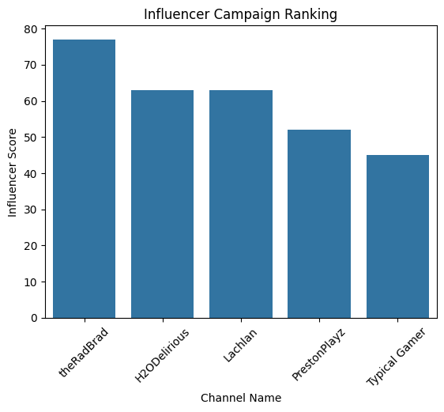
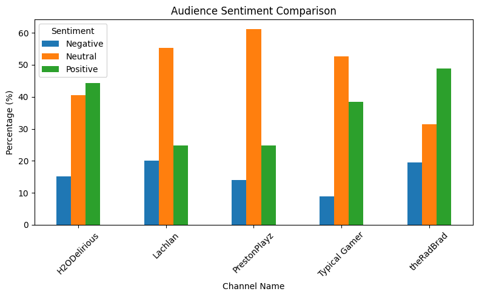
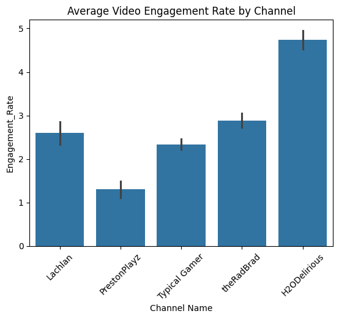
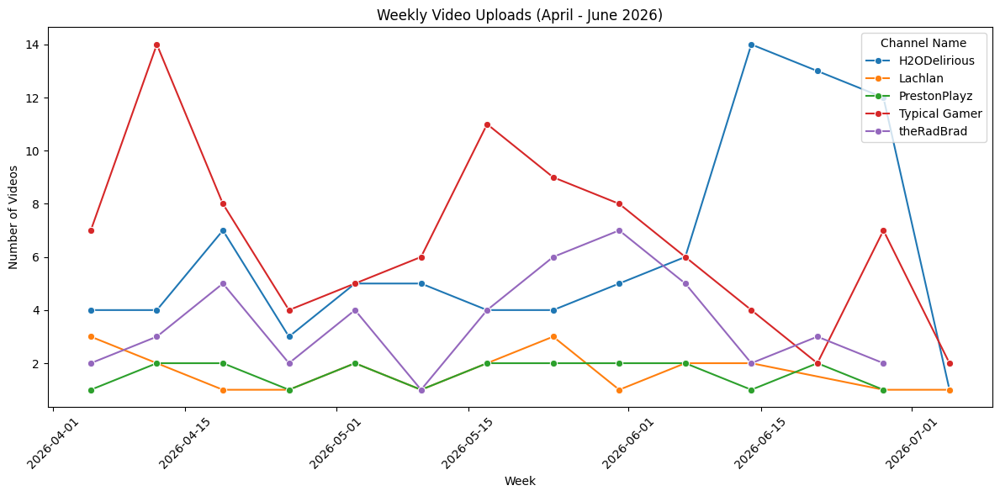

# Gaming Influencer Selection: YouTube Engagement & Sentiment Analysis

A data analysis project that picks the best gaming YouTuber for an influencer marketing campaign. It combines video performance, audience engagement and comment sentiment (NLP) into one weighted score.

*Course project: Web Analytics, University of Jeddah*

## Problem

A brand wants to run a campaign with one gaming creator. Subscriber count alone can be misleading, so this project asks a different question: **which channel gets reliable views, an engaged audience, and a positive community?**

## Data

Collected live with the **YouTube Data API v3** for videos published **April–June 2026** by 5 channels:

| Channel | Videos | Total views |
|---|---|---|
| H2ODelirious | 87 | 14.3M |
| Lachlan | 20 | 17.7M |
| PrestonPlayz | 21 | 52.0M |
| Typical Gamer | 93 | 13.7M |
| theRadBrad | 46 | 21.3M |

- **267 videos** with views, likes and comment counts
- **Comments:** a random 15% sample per video, capped at 300 per video

## Workflow

1. **Data collection:** pull each channel's uploads playlist, video statistics and comment threads through the API, with pagination
2. **Engagement analysis:** engagement rate = (likes + comments) / views × 100, plus weekly upload frequency
3. **Text cleaning:** lowercase the text, then remove URLs, special characters and extra whitespace (regex)
4. **Sentiment analysis:** VADER compound score, labeled Positive (> 0.05), Negative (< -0.05) or Neutral
5. **Influencer score:** a weighted ranking built from percentile scores:
   - 40% median views (median is used so one viral video doesn't skew the result)
   - 35% average engagement rate
   - 25% share of positive comments

## Results

| Rank | Channel | Median views | Avg engagement | Positive comments | Score |
|---|---|---|---|---|---|
| 1 | **theRadBrad** | 302K | 2.89% | 48.9% | **77** |
| 2 | H2ODelirious | 86K | 4.73% | 44.4% | 63 |
| 3 | Lachlan | 371K | 2.59% | 24.7% | 58 |
| 4 | PrestonPlayz | 2.51M | 1.30% | 24.9% | 57 |
| 5 | Typical Gamer | 91K | 2.33% | 38.5% | 45 |

**Key insight:** PrestonPlayz has by far the most views (2.5M median), but it ranks 4th because it has the lowest engagement rate and a mostly neutral audience. **theRadBrad** gives the best balance of reach, engagement and positive sentiment, so it is the recommended pick.

> Comments are randomly sampled, so scores can shift slightly between runs.






## Tech Stack

Python · pandas · YouTube Data API v3 · VADER (NLP sentiment) · regex · Matplotlib · seaborn · Jupyter / Google Colab

## How to Run

```bash
git clone https://github.com/omarsait/youtube-influencer-analysis.git
cd youtube-influencer-analysis
pip install -r requirements.txt
```

1. Create a YouTube Data API v3 key in [Google Cloud Console](https://console.cloud.google.com/).
2. Set it as an environment variable: `YOUTUBE_API_KEY=your_key`. If you don't, the notebook asks for it when it runs.
3. Run `youtube_influencer_analysis.ipynb`.

## Limitations & Next Steps

- VADER is built for English. Slang, sarcasm and gaming terms (e.g. "this is sick") can be misclassified.
- Try a transformer-based sentiment model (e.g. a RoBERTa model fine-tuned on social media)
- Add more channels and a longer time window
